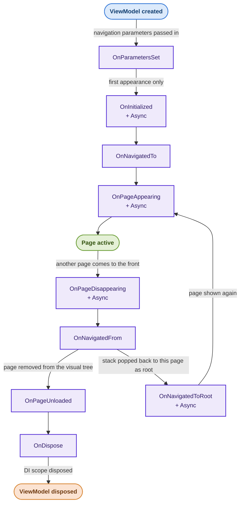

# MvvmEssentials

Lightweight MVVM utility library for .NET MAUI that simplifies navigation, flyout menus, tabs, popups, and multi-step wizards with opinionated conventions and minimal boilerplate. An alternative to .NET MAUI Shell.

[](https://github.com/mr5z/MvvmEssentials/actions/workflows/dotnet.yml)
[](https://www.nuget.org/packages/Nkraft.MvvmEssentials/)
[](https://www.nuget.org/packages/Nkraft.MvvmEssentials/)

[](https://en.wikipedia.org/wiki/Code_coverage)
[](https://en.wikipedia.org/wiki/Cyclomatic_complexity)
[](https://testing.googleblog.com/2011/02/this-code-is-crap.html)

## Page types

This page covers setup and the concepts shared by every page type. For usage of a specific
surface, see its guide:

- [NavigationPage](https://github.com/mr5z/MvvmEssentials/blob/main/docs/navigation-page.md) — plain pages and the navigation service (push/replace, strongly-typed parameters)
- [TabbedPage](https://github.com/mr5z/MvvmEssentials/blob/main/docs/tabbed-page.md) — bottom/top tabs with lifecycle propagation
- [FlyoutPage](https://github.com/mr5z/MvvmEssentials/blob/main/docs/flyout-page.md) — hamburger menu with a swappable detail area
- [Modals](https://github.com/mr5z/MvvmEssentials/blob/main/docs/modals.md) — pages that return a result, with the same top bar as regular pages
- [Popups](https://github.com/mr5z/MvvmEssentials/blob/main/docs/popups.md) — modal dialogs with result handling (powered by [Nkraft.Mopups](https://www.nuget.org/packages/Nkraft.Mopups/), a maintained fork of Mopups)
- [Wizard](https://github.com/mr5z/MvvmEssentials/blob/main/docs/wizard.md) — multi-step flows over a shared state object
- [Sections](https://github.com/mr5z/MvvmEssentials/blob/main/docs/sections.md) — bindable parts of a page, scoped to it and disposed with it

# Setup

Quick test using this [Food Delivery app](https://github.com/mr5z/ShowCase-FoodDelivery), or just follow the instructions below.

## 1. Configure in `MauiProgram.cs`

```cs
public static class MauiProgram
{
    public static MauiApp CreateMauiApp()
    {
        var builder = MauiApp.CreateBuilder();
        builder
            .UseMauiApp<App>()
            .ConfigureMvvmEssentials(registry =>
            {
                // ViewModel and Page naming convention must strictly be followed:
                // page_name + "Page", vm_name + "ViewModel", wherein page_name == vm_name
                //
                // Mark one page with isInitial: true. This is where the app starts.
                // If you need conditional startup logic (e.g. auth checks),
                // implement IAppStartup instead (see below).
                registry.MapPage<LandingPage, LandingViewModel>(isInitial: true)
                    .MapPage<MainPage, MainViewModel>()
                    .MapPage<LoginPage, LoginViewModel>()
                    .MapPage<SettingsPage, SettingsViewModel>();
            });

        // Required: registers the auto-discovered or generated IAppStartup
        builder.Services.AddDiscoveredAppStartup();

        // ..
    }
}
```

> **Note:** `AddDiscoveredAppStartup()` is source-generated at compile time, only in the project that
> calls it. It automatically wires up your `IAppStartup` implementation if one exists, or generates a
> default one from the page marked `isInitial: true`.

> **Note:** `ConfigureMvvmEssentials` also configures popups for you. Do not call `ConfigureMopups()` yourself.

## 2. Wire up the window in `App.xaml.cs`

```cs
public partial class App : Application
{
    private readonly AppStartupWindowHook _hook;

    public App(AppStartupWindowHook hook)
    {
        _hook = hook;
        InitializeComponent();
    }

    protected override Window CreateWindow(IActivationState? activationState)
    {
        _hook.Attach();
        return base.CreateWindow(activationState);
    }
}
```

That's it. The hook fires the initial navigation automatically.

## 3. Delete any `Shell` related files. They are not used here.

---

# Custom Startup Logic (Optional)

If you need to run async logic before deciding where to navigate (e.g. auth checks, feature flags),
implement `IAppStartup` in your app project or in a project it references (e.g. a separate ViewModel
library). The source generator will find it automatically, no registration needed.

```cs
public class AppStartup(INavigationService navigationService, IAuthService authService) : IAppStartup
{
    private readonly INavigationService _navigationService = navigationService;
    private readonly IAuthService _authService = authService;

    async Task<IResult> IAppStartup.OnInitializedAsync()
    {
        var isLoggedIn = await _authService.CheckAsync();

        // Return the navigation result: the library rethrows a failure's original exception.
        return await _navigationService
            .Absolute(withNavigation: false)
            .Push(isLoggedIn ? typeof(HomeViewModel) : typeof(LoginViewModel))
            .NavigateAsync();
    }
}
```

> **Why return the result?** If startup navigation fails (e.g. a ViewModel constructor throws), the library
> rethrows the real exception instead of MAUI's generic "set MainPage" error. To recover instead, navigate to a
> fallback page and return that result. Lifecycle exceptions are handled separately (see [Lifecycle Exceptions](#lifecycle-exceptions)).

> **Rules:**
> - Only one `IAppStartup` implementation is allowed across your app and its referenced projects. Defining two will produce a **compile error (MVE002)**.
> - If it lives in a referenced project, it must be `public`. Otherwise you get a **compile error (MVE007)**.
> - If no `IAppStartup` is found and no page is marked `isInitial: true`, a **compiler warning (MVE001)** is emitted.
> - Mark one page only, with `isInitial: true` or just `true`. Marking two produces a **compile error (MVE008)**. The flag must be the literal `true`: a variable or expression can't be read at compile time, so it counts as unmarked.
> - When `IAppStartup` is defined, the `isInitial: true` flag is ignored.

---

# MapPage vs RegisterPage vs MapView vs RegisterSection

All four register a ViewModel with a scoped lifetime in the DI container, but they serve different roles:
| | `MapPage<TPage, TViewModel>` | `RegisterPage<TViewModel>` | `MapView<TView, TViewModel>` | `RegisterSection<TSection>` |
|---|---|---|---|---|
| Navigable via `NavigateAsync` | ✅ Yes | ❌ No | ❌ No | ❌ No |
| Creates a mapping | ✅ Page–VM | ❌ No | ✅ ContentView–VM | ❌ No |
| Scoped DI lifetime | ✅ Yes | ✅ Yes | ✅ Yes | ✅ Yes |
| Use for | Pages navigated to by the navigation service | VMs bound via XAML (tabs, flyout menu) | Views built by VM type (wizard steps) | Parts of a page, injected into its VM |

Use `MapView` when a ViewModel asks for its view by VM type alone, as wizard steps do with
`CreateView<TViewModel>()`. This keeps ViewModels free of view types, so they can live in a separate
project from your views. See [Wizard](https://github.com/mr5z/MvvmEssentials/blob/main/docs/wizard.md).

Use `RegisterPage` for any ViewModel that is wired to its page or view via XAML `BindingContext`
rather than created by the navigation service. The navigation service has no knowledge of these VMs
and will not be able to navigate to them by name.

Use `RegisterSection` for a `SectionViewModel`: a part of a page that the page's ViewModel takes as a
constructor dependency and exposes as a property. See
[Sections](https://github.com/mr5z/MvvmEssentials/blob/main/docs/sections.md).

The flyout's initial detail is the one exception: it is bound in XAML like the others, but if your
app returns to it (for example, a "home" action in the menu), it must use `MapPage` so the navigation
service can find it again.
```cs
registry.MapPage<MainHostPage, MainHostViewModel>(isInitial: true) // navigatable
    .RegisterPage<MenuViewModel>()        // bound in XAML as FlyoutPage.Flyout
    // Ideally RegisterPage, but the flyout has to return to its initial detail page, which needs MapPage.
    .MapPage<MainTabbedPage, MainTabbedViewModel>() // bound in XAML as FlyoutPage.Detail
        .RegisterPage<HomeViewModel>()      // bound in XAML as a TabbedPage tab
        .RegisterPage<ProfileViewModel>()   // bound in XAML as a TabbedPage tab
    .MapPage<OnboardingHostPage, OnboardingHostViewModel>() // navigatable wizard host
        .MapView<OnboardingGoalView, OnboardingGoalViewModel>() // wizard step
    .MapPage<OrdersPage, OrdersViewModel>()      // navigable
    .MapPage<SettingsPage, SettingsViewModel>(); // navigable
```

---

# ViewModel Lifecycle

Every page-backing ViewModel derives from `PageViewModel` and shares the lifecycle below. Surface-specific
hooks (tabs, flyout menus, wizard steps) are documented in each page type's guide.

<details>
<summary>PageViewModel</summary>

| Method | When it is called |
|---|---|
| `OnParametersSet` | Called when navigation parameters are passed to this ViewModel |
| `OnInitialized` | Called once on the first page appearing |
| `OnInitializedAsync` | Async version of `OnInitialized` |
| `OnPageAppearing` | Called every time the page appears |
| `OnPageAppearingAsync` | Async version of `OnPageAppearing` |
| `OnPageDisappearing` | Called every time the page disappears |
| `OnPageDisappearingAsync` | Async version of `OnPageDisappearing` |
| `OnNavigatedTo` | Called when the page is navigated to |
| `OnNavigatedFrom` | Called when the page is navigated away from |
| `OnNavigatedToRoot` | Called when the navigation stack is popped back to this page as root |
| `OnNavigatedToRootAsync` | Async version of `OnNavigatedToRoot` |
| `OnPageUnloaded` | Called when the page is removed from the visual tree |
| `OnDispose` | Called when the DI scope is disposed |


</details>

---

# Resource Cleanup (IDisposable)

All ViewModels (`PageViewModel`, `TabViewModel`, `FlyoutMenuViewModel`, `PopupViewModel`, `WizardStepViewModel`, `SectionViewModel`) implement `IDisposable`. When a page is unloaded, the library automatically disposes its ViewModel via the DI scope, along with every section registered for it.

To clean up resources, override `OnDispose()` in your ViewModel:

```cs
public class MyViewModel : PageViewModel
{
    private readonly Timer _timer;

    public MyViewModel()
    {
        _timer = new Timer(OnTick, null, 0, 1000);
    }

    protected override void OnDispose()
    {
        base.OnDispose();
        _timer.Dispose();
    }
}
```

---

# Lifecycle Exceptions

Lifecycle methods (`OnInitialized`, `OnPageAppearing`, `OnNavigatedTo`, `OnTabSelected`, `OnFlyoutOpened`, ...
and their async versions) are called by MAUI while it is navigating. An exception from one of them never
propagates into MAUI or fails the navigation: the page still opens, and the exception is reported instead.

Every such exception goes through one place, configured with the `ConfigureMvvmEssentials` overload:

```cs
builder.ConfigureMvvmEssentials(
    registry => registry.MapPage<LandingPage, LandingViewModel>(isInitial: true),
    options =>
    {
        // Crash (default): rethrows the original exception on the UI thread after the navigation
        // finishes, so it reaches your unhandled-exception handler.
        // LogOnly: logs it and keeps the app running.
        options.LifecycleExceptionBehavior = LifecycleExceptionBehavior.Crash;

        // Called first, for every lifecycle exception.
        options.OnLifecycleException = context =>
        {
            // e.g. send to your crash reporter
            MyCrashReporter.Track(context.Exception, context.MethodName, context.Source?.GetType().Name);

            // Optionally keep running for this one exception, even with Crash.
            // context.Handled = true;
        };
    });
```

- `context.MethodName` is the method the library was calling. `OnInitialized`/`OnInitializedAsync` run inside
  `OnPageAppearing`/`OnPageAppearingAsync` and are reported under those names; the stack trace shows the exact method.
- `context.Source` is the ViewModel (or tab/flyout component) that threw.
- Don't assume the callback runs on the UI thread.
- Handle errors you expect (e.g. a failed API call) inside the lifecycle method and show them on the page.
  This mechanism is for the ones you don't expect.
- A failed `OnInitialized` is not retried on the next appearance.
- Not covered: exceptions from `OnParametersSet` or the ViewModel constructor (navigation hasn't started, so the
  returned `IResult` fails instead), and from `OnNavigatedToRoot` (reported in the `IResult` of `NavigateToRootAsync`).

---

# Upgrading

Changes that may need edits in your app, and how to make them, are listed in the
[migration guide](https://github.com/mr5z/MvvmEssentials/blob/main/docs/migration.md).

---

# Contributing

Contributions are welcome. To get started:

1. Fork the repository
2. Create a feature branch (`git checkout -b feature/my-change`)
3. Commit your changes (`git commit -am 'Add my change'`)
4. Push to the branch (`git push origin feature/my-change`)
5. Open a pull request

Please open an issue first for significant changes so the direction can be discussed before implementation.
